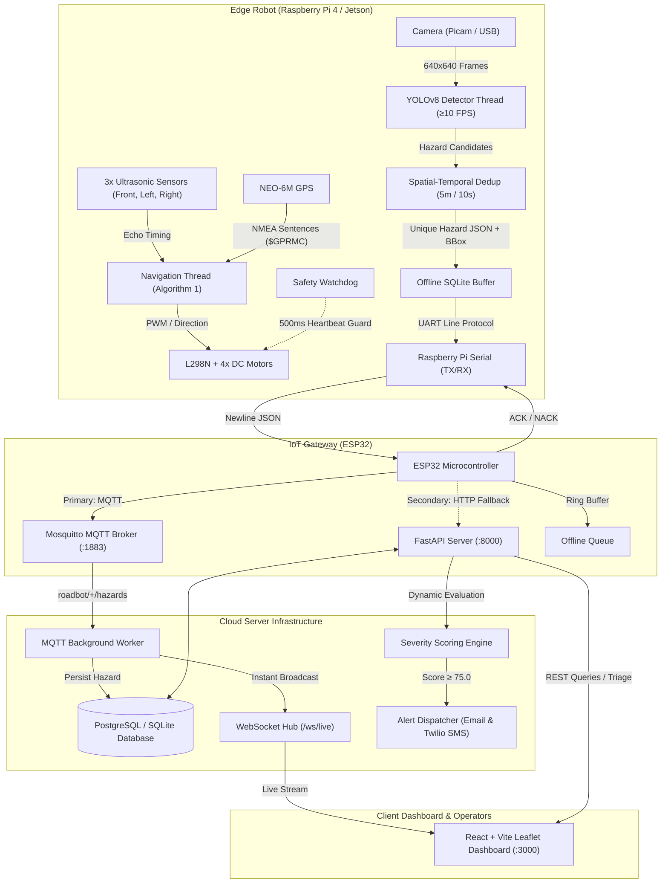

# System Architecture: IoT Road Hazard Detection Robot

A high-reliability, edge-computed, autonomous road hazard inspection platform that couples real-time computer vision inference (YOLOv8) on an edge robot with an IoT uplink gateway (ESP32) and cloud fleet management infrastructure (FastAPI, Mosquitto, PostgreSQL, React Leaflet).

---

## 1. End-to-End System Diagram



---

## 2. Component Details

### A. Edge Robot Application (`robot/`)
- **Execution Model**: Multithreaded architecture separating real-time safety critical navigation (~50 Hz) from computer-vision inference (~12-15 FPS).
- **Navigation (Algorithm 1)**:
  - Continuously polls front, left, and right ultrasonic distances.
  - If front < 30 cm, triggers avoidance maneuver: emergency brake -> reverse (600 ms) -> steer away from obstacle (1000 ms) -> re-evaluate clearance -> resume waypoint trajectory.
- **Hardware Abstraction Layer (HAL)**:
  - `HALBase`: Abstract interfaces for motors, sensors, camera, GPS, and serial.
  - `HardwareHAL`: Concrete drivers for Raspberry Pi GPIO pins (`gpiozero`/`RPi.GPIO`), hardware UART (`pyserial`), and OpenCV/V4L2 camera capture.
  - `MockHAL`: Full software mock with obstacle simulation and synthetic road generation, enabling complete local test runs on any developer PC.
- **Safety Watchdog**:
  - Independent daemon thread verifies that the navigation loop pets the watchdog within 500 ms.
  - If the thread hangs, freezes, or crashes, the watchdog immediately stops all motors via hardware emergency shutdown.
- **Spatial-Temporal Deduplication**:
  - Avoids flooding notifications for the same pothole or crack.
  - Uses haversine distance formula: ignores detections of the same class within 5.0 meters and within 10.0 seconds of an earlier report.

### B. IoT Gateway Firmware (`firmware/`)
- **Microcontroller**: ESP32 DevKit v1 running Arduino/C++ firmware.
- **UART Frame Protocol**:
  - Pi sends: `{"seq": 101, "cmd": "HAZARD", "data": {...}}\n`
  - ESP32 verifies checksum/syntax and returns: `{"ack": 101, "status": "OK"}\n`
- **Dual-Uplink Strategy**:
  1. *Primary*: MQTT publishing to `roadbot/{robot_id}/hazards` with QoS 0/1.
  2. *Secondary Fallback*: Direct HTTP POST to `/api/hazards` with `X-Robot-Key` if MQTT broker is unreachable.
  3. *Offline Ring Buffer*: 20-slot non-volatile RAM queue buffers payloads if Wi-Fi drops, auto-retransmitting on reconnect.
- **Heartbeat & Telemetry**:
  - Dispatches robot battery voltage, Wi-Fi RSSI, uptime, and free heap memory every 10 seconds to `roadbot/{robot_id}/heartbeat`.

### C. Cloud Backend (`backend/`)
- **Framework**: FastAPI (asynchronous ASGI server) running with SQLAlchemy 2.0.
- **Database Support**: Dual-mode support: SQLite for local developer velocity and zero-dependency testing, and PostgreSQL in production Docker Compose.
- **Real-Time Push**:
  - Mosquitto MQTT background worker listens to incoming edge packets, ingests them into the database, and immediately broadcasts them through WebSocket `/ws/live` to active operators.
- **Severity Scoring Algorithm**:
  ```python
  Base Weight: Pothole = 80, Crack = 60, Animal = 90
  Clustering Multiplier: min(1.0 + (cluster_count - 1) * 0.15, 2.0)
  Severity Score = min(100.0, base_weight * confidence * clustering_multiplier)
  ```
- **Alert Dispatch Engine**:
  - Dispatches automated notifications via SMTP (Email) and Twilio (SMS) when a hazard exceeds the configured severity threshold (default: 75.0).
  - Rate-limiting prevents alert flooding within a 15-minute sliding window.

### D. Operations Dashboard (`dashboard/`)
- **Frontend Stack**: React 18, TypeScript, Vite, Tailwind CSS, Lucide icons, Leaflet with OpenStreetMap.
- **Live Visuals**:
  - Real-time animated markers color-coded by class (🔴 Pothole, 🟡 Crack, 🔵 Animal).
  - Hazard density heatmap layer.
  - Live robot GPS pin and trajectory breadcrumbs.
  - Priority repair queue ranked dynamically by severity score.
  - One-click triage status updater (`new` -> `acknowledged` -> `repaired`).
